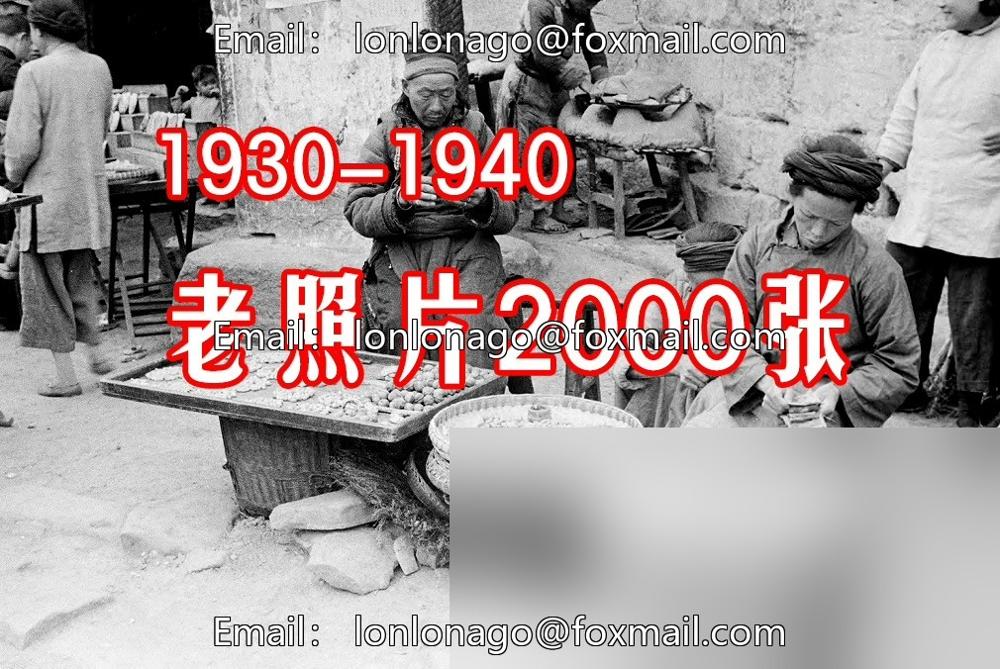
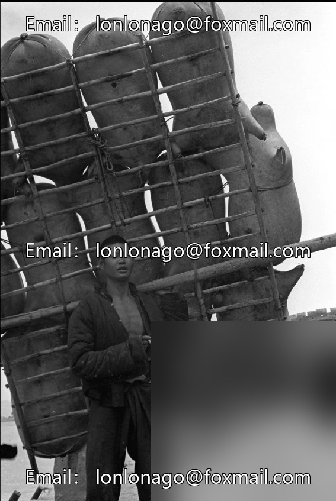
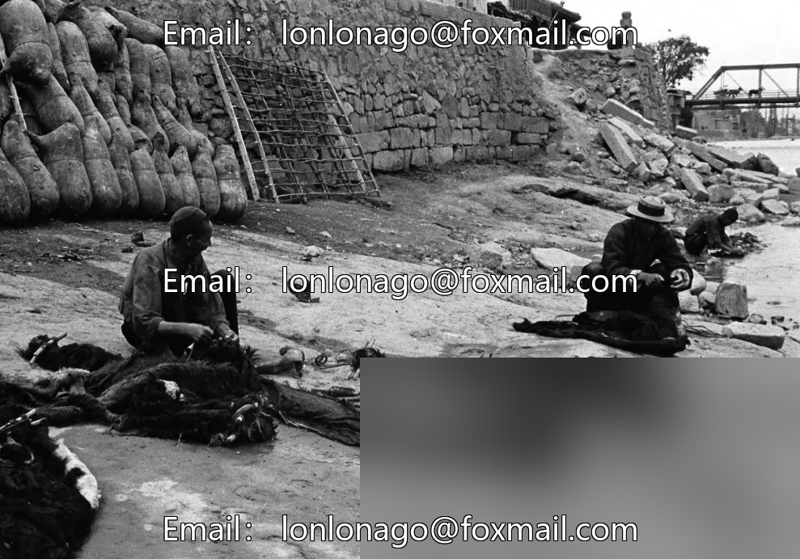
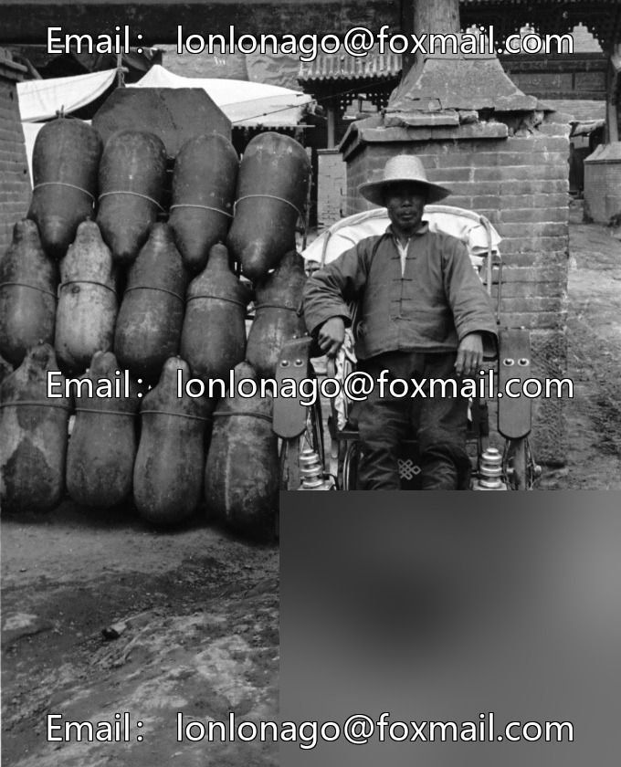
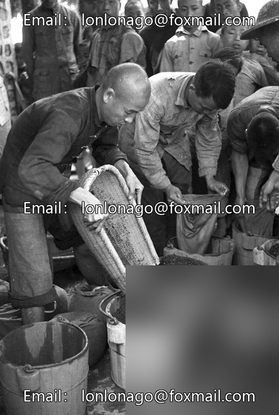
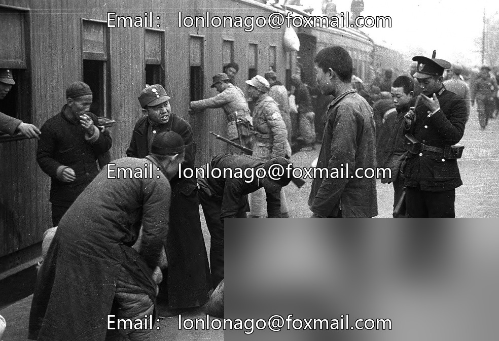
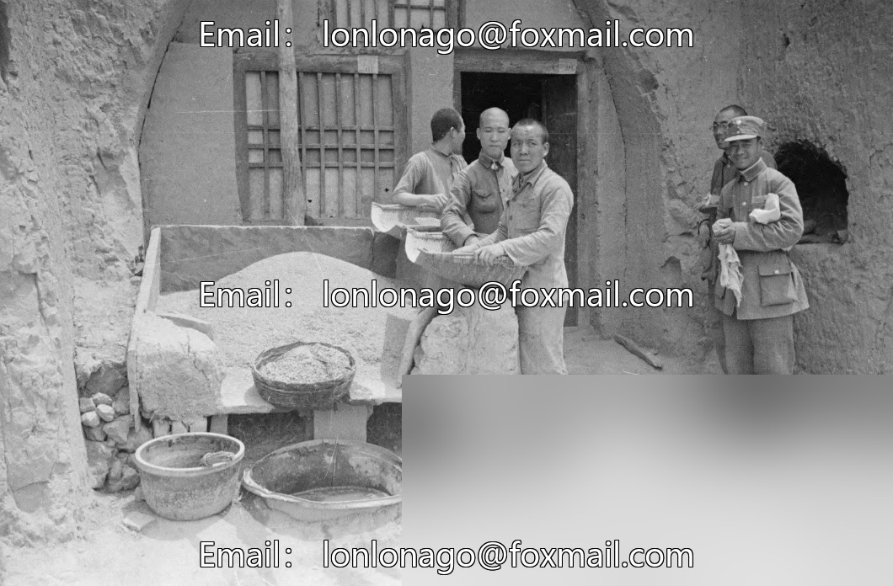

# Post-War era old photos, nostalgic historical old photos from around the 1930-1940 years

## Body

Military and Republican era old photographs, nostalgic historical old photographs of the people's life situations around the period of the Anti-Japanese War from around 1930-1940, totaling more than 2,000, with a small portion slightly blurry due to the long history of the era, while the majority have good clarity. The cities involved include: Changde, Chengdu, Ganzhou, Guangzhou, Guiyang, Guilin, Lanzhou, Nanjing, Changsha, Xuzhou, Xi'an, Wuhan, etc.

web disk sharing, can be directly picked up.
I have been online for a long time, shipping will be dispatched immediately.

The dataset includes Nincian old photographs, anti-Martyah nostalgic historical photos around 1930-1940, and daily life scenes from 1930-1940; total more than 2,000 images, most clear, with city and location distribution information included.

<!-- AI_ENRICHED -->

## Images

## Payment

Here is a pay link on Stripe ( https://buy.stripe.com/3cs8yP7sY87d0vu9AB ). Please contact me lonlonago@foxmail.com after funding $89, and I will send you a complete data files , thank you!

